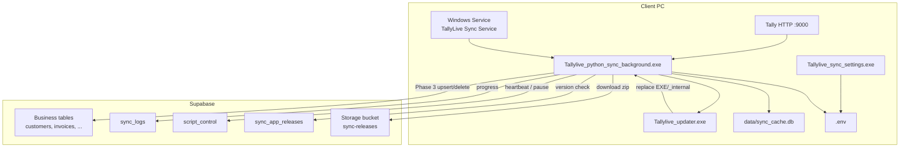

# TallyLive Sync

Windows background service that syncs **Tally ERP / TallyPrime** data to **Supabase (TallyLive)**.

| Item | Value |
|------|--------|
| Current app version | See `src/version.py` (`APP_VERSION`) |
| Runtime | Python 3.12, packaged with PyInstaller |
| Install | Inno Setup → Windows service (WinSW-style wrapper) |
| Local cache | SQLite `data/sync_cache.db` next to the sync EXE |
| Cloud | Supabase (PostgREST + Storage) |

This document describes architecture, features, control flow, invariants, build/release, and ops so a new developer or AI assistant can work on the project safely.

---

## 1. What the product does

1. Discovers companies open in Tally (HTTP XML API, usually `localhost:9000`).
2. For each company, extracts masters and vouchers into a **local SQLite** database (Phase 1).
3. Uploads pending rows to **Supabase** (Phase 3) without holding Tally under load.
4. Reports progress in Supabase table **`sync_logs`** (`running` → `uploading` → final status).
5. Respects remote pause / license expiry via **`script_control`**.
6. Can **auto-update** itself from Supabase Storage when a newer release is marked active.
7. Ships with a **Settings UI** and a single **Setup EXE** for client machines.

---

## 2. High-level architecture



### Three phases (per company)

| Phase | Name | What happens |
|-------|------|----------------|
| **1** | Extract | Talk to Tally; stage rows into SQLite as `_sync_status=pending`. Heavy Tally use. |
| **2** | Idle | Log-only marker: Tally is free; no separate code module. |
| **3** | Upload | Push pending SQLite rows + staged deletions to Supabase. Status = `uploading`. |

Important: many functions are named `save_*_to_supabase` for history, but in the current design they **stage to local SQLite**. Cloud write is Phase 3 (`push_all_pending_to_supabase`).

---

## 3. Repository layout

```
python_sync_tallylive/
├── main.py                 # Service loop + 13-step sync orchestration
├── build_installer.py      # Clean build → PyInstaller ×3 → zip → Inno Setup
├── requirements.txt
├── .env / .env.example     # Client config (host, port, interval, reconcile)
├── src/
│   ├── version.py          # APP_VERSION (single source of truth)
│   ├── config.py           # load_config(); baked Supabase fallbacks
│   ├── paths.py            # EXE dir, .env path, install root, updater path
│   ├── env_file.py         # Read/write .env; clear FULL_RECONCILE
│   ├── error_format.py     # Rich errors for sync_logs.error_details
│   ├── sync_logger.py      # sync_logs row lifecycle
│   ├── auto_update.py      # Check release, download, hand off to updater
│   ├── local_db.py         # SQLite schema, stage, Phase 3 push
│   ├── tally_client.py     # Tally HTTP helpers / XML decode
│   ├── source_values.py    # Parsing helpers; FULL_RECONCILE watermark reset
│   └── *.py                # Domain extractors (ledgers, stock, bills, ...)
├── settings_ui/            # Tkinter Settings app source
├── updater/                # Detached updater source
├── installer/
│   ├── TallyLiveSync.iss   # Inno Setup script
│   ├── IT_ALLOWLIST.txt    # Firewall/AV guide (shown in Setup + installed)
│   ├── tallylive_sync.ico
│   └── supabase_sync_app_releases.sql
├── *.spec                  # PyInstaller specs (background, settings, updater)
├── dist_deployment/        # Assembled payload for packaging (build output)
├── installer_output/       # Setup_*.exe + versioned update zip + .sha256.txt
├── test_*.py               # Unit / regression / auto-update tests
├── pyinstaller_src/        # Vendored PyInstaller sources (not app logic)
└── venv/                   # Local virtualenv
```

Ignore for product logic: `pyinstaller_src/`, `venv/`, `__pycache__/`.

---

## 4. Runtime loop (`main.py`)

```
start service
  load .env
  loop forever:
    run_sync_cycle()          # all open companies
    clear FULL_RECONCILE if it was 1
    check_and_apply_update()  # may exit process for updater
    sleep(SYNC_INTERVAL)      # re-read from .env each loop
```

### Per-company cycle (13 steps)

| # | Module | Local / cloud table | Notes |
|---|--------|---------------------|--------|
| 1 | `tally_companies` | `tally_companies` | Then `check_script_control`; skip company if paused/expired |
| 2 | `ledgers` | `customers` | Customers/suppliers; delete reconcile |
| 3 | `godowns` | `tally_godowns` | Delete reconcile |
| 4 | `cost_centers` | `tally_cost_centers` | Delete reconcile |
| 5 | `stock_items` | `stock_items` | Masters + balances; balance-only if no master delta |
| 6 | `sale_bill` | `sales_invoices` | Delete reconcile |
| 7 | `sale_bill_item` | `invoice_items` | Needs parent invoice GUIDs |
| 8 | `purchase_bill` | `purchase_invoices` | Delete reconcile |
| 9 | `purchase_bill_item` | `invoice_items_purchase` | |
| 10 | `outstanding_receivables` + `invoice_status` | `outstanding_receivables` | Also sets sales invoice Pending/Paid |
| 11 | `outstanding_payables` + `invoice_status` | `outstanding_payables` | Also sets purchase invoice Pending/Paid |
| 12 | `daybook` | `tally_daybook` | Delete reconcile |
| 13 | `settled_bills` | `ledger_bill_settlements` | Incremental by alter_id / payment activity |

Step success/failure updates **`sync_logs`** live. After step 13 → `mark_uploading()` → Phase 3 → `finish()`.

### Final `sync_logs.status`

| Status | Meaning |
|--------|---------|
| `running` | Phase 1 in progress |
| `uploading` | Phase 3 SQLite → Supabase |
| `completed` | All 13 steps passed and upload OK |
| `partial` | Some steps failed and/or upload incomplete |
| `failed` | Abort / nothing passed |

`error_details` holds human-readable reasons (exception type, message, API code/hint when present, Phase 3 table errors). Optional column `app_version`.

---

## 5. Local database (`src/local_db.py`)

- Path: `{sync_exe_dir}/data/sync_cache.db`
- Business tables listed in `ALL_TABLES` / `TABLE_MAP`
- Internal columns: `_sync_status` (`pending` / `synced` / `failed`), `_synced_at`, `_sync_error`
- Deletes: staged in `pending_deletions` `(table_name, company_name, guid)` then applied in Phase 3
- **Company scoping:** every row must have non-blank `company_name`; queries use exact match only
- **Upsert conflict keys (Supabase):**
  - Most tables: `company_name,guid` (`COMPOSITE_CONFLICT`)
  - `tally_companies`: `guid` (`COMPANY_MASTER_CONFLICT`)

Phase 3 order follows `ALL_TABLES` (companies → masters → vouchers → line items → outstanding → daybook → settlements).

Failed uploads remain pending/failed for the next cycle (**no silent data loss**).

---

## 6. Configuration

### `.env` (next to sync EXE)

| Variable | Default | Purpose |
|----------|---------|---------|
| `TALLY_HOST` | `localhost` | Tally host |
| `TALLY_PORT` | `9000` | Tally HTTP port |
| `SYNC_INTERVAL` | `1800` (seconds) | Sleep between cycles; Settings UI edits minutes |
| `FULL_RECONCILE` | `0` | `1` = one-shot full re-read (watermarks → 0), then cleared |
| `SYNC_VALIDITY` | e.g. `14d` | Default license window for new `script_control` rows |
| `SYNC_START_YEAR` | unset | Optional financial-year override |
| `SUPABASE_URL` / `SUPABASE_KEY` | optional | Override baked-in defaults in `config.py` |

`load_config()` always reloads `.env` from the app directory (settings changes apply on the next cycle without reinstall).

### Settings UI

- Fields: host, port, interval (minutes), full reconcile, **version display**
- Writes the same `.env` keys via `src/env_file.py`
- Start Menu shortcut; optional desktop icon at install time
- **Not** a separate uninstallable product — removed only with “TallyLive Sync”

### Inno Setup installer

- Wizard: host / port / interval / full reconcile → writes `.env`
- Shows `IT_ALLOWLIST.txt` before install
- Installs service + Settings + updater under `{autopf}\TallyLive Sync\`
- Success message; single Apps & features entry: **TallyLive Sync**

---

## 7. Remote control (`script_control`)

Keyed by **`machine_name`** = Windows hostname.

| Field | Role |
|-------|------|
| `sync_should_run` | Remote pause switch |
| `expires_at` | Subscription / license end |
| `current_company` | Last company seen |
| `last_seen_at` | Heartbeat |
| `app_version` | Optional; reported by sync |

Behavior:

- Missing row → insert (should run = true, expiry from `SYNC_VALIDITY`)
- `sync_should_run = false` or past `expires_at` → skip sync for that company
- Supabase unreachable → keep **last known** state (default allow on first failure)

---

## 8. Auto-update

### Components

| Piece | Role |
|-------|------|
| `src/auto_update.py` | After idle cycle: query active release, download, verify SHA256, launch updater |
| `updater/updater_main.py` | Stop service → backup → extract zip → preserve config/data → start service / rollback |
| Supabase table `sync_app_releases` | Metadata: version, storage_path, sha256, is_active |
| Storage bucket `sync-releases` | Versioned zip files |

### Client flow

1. Sync cycle finishes.
2. Read active row from `sync_app_releases`.
3. If remote version **>** local `APP_VERSION` → download zip from Storage.
4. Verify SHA256; reject on mismatch.
5. Write `update_pending.json`; start `Tallylive_updater.exe`; sync process exits.
6. Updater replaces program files under `Tallylive_python_sync_background\`.
7. **Preserved:** `.env`, `data\` (including `sync_cache.db`), `sync.log`.

### Release (ops)

1. Bump `APP_VERSION` in `src/version.py`.
2. Run `python build_installer.py`.
3. Upload `installer_output/Tallylive_python_sync_background_{ver}.zip` to  
   `sync-releases/{ver}/Tallylive_python_sync_background_{ver}.zip`.
4. Insert row in `sync_app_releases`; set **only that row** `is_active = true`.
5. Use SHA from `*.zip.sha256.txt`.
6. New PCs: ship `Setup_TallyLive_Sync_{ver}.exe`. Existing PCs: auto-update.

SQL bootstrap + RLS notes: `installer/supabase_sync_app_releases.sql`.

Keep only the latest 2–3 zips in Storage to limit size.

---

## 9. Alter ID, upsert, and delete (data movement)

### Alter ID (what to fetch from Tally)
- Local watermark: `get_max_alter_id_local(table, company)` = max stored `alter_id` for that company.
- `reconcile_from_id(...)` returns `0` when `FULL_RECONCILE=1`, else the watermark.
- Tally XML filter (when watermark > 0): `$AlterId > {max}` — only new/changed masters/vouchers.
- First run / empty local table / full reconcile → no AlterId filter (broader fetch).
- Stock may force a fuller master fetch if local GUIDs are missing even when watermark > 0.
- Some paths always refresh live values (e.g. stock balances, outstanding) beyond pure Alter ID.

### Local write (`save_to_local_db`)
- SQLite `INSERT ... ON CONFLICT(company_name, guid) DO UPDATE` → **upsert**.
- Sets `_sync_status = pending` for Phase 3 upload.

### Cloud write (Phase 3)
- Pending rows: Supabase `.upsert(..., on_conflict="company_name,guid")` (companies: `guid` only).
- Success → mark `synced`; failure → stay pending/failed with `_sync_error`.

### Delete
- Reconcile active Tally GUIDs vs local → `stage_deletions` → `pending_deletions`.
- Phase 3: delete Supabase rows by guid (invoice children first); clear pending deletion entries.
- Guard: empty active GUID set → skip mass delete.

## 10. Deleted / cancelled vouchers (Tally → cloud)

Sales and purchase vouchers that are **deleted** or **cancelled** in Tally are removed from local SQLite and then from Supabase.

**Mechanism**
1. During voucher fetch, `ISDELETED=Yes` or `ISCANCELLED=Yes` vouchers are not saved as live invoices; their GUIDs may be staged for deletion.
2. `reconcile_deleted_sale_bills` / `reconcile_deleted_purchase_bills` load **all active** voucher GUIDs for the current FY from Tally.
3. Local rows for that company whose GUID is **not** in the active set are passed to `reconcile_local_deletions` → `stage_deletions` (purge local + queue `pending_deletions`).
4. **Safety:** if Tally returns **0** active GUIDs (or the fetch fails), reconciliation **skips** deletion to avoid a full wipe.
5. Phase 3 processes `pending_deletions`: for `sales_invoices` / `purchase_invoices`, delete child `invoice_items` / `invoice_items_purchase` first, then delete the parent by `guid` (+ `company_name` scope).

Similar GUID reconciliation exists for customers, godowns, cost centers, stock items, and daybook.

## 11. Important logic conditions / invariants

1. **Multi-company:** Loop all companies currently open in Tally; never mix rows across `company_name`.
2. **Phase order:** Never run Phase 3 until Phase 1 for that company is done (frees Tally).
3. **FULL_RECONCILE:** Forces incremental watermarks to 0 for one cycle, then auto-clears to `0`.
4. **Offline-tolerant extract:** Phase 1 can succeed while Phase 3 fails; data stays in SQLite.
5. **`sync_logs` needs network:** Progress/errors in Supabase require connectivity; local `sync.log` always writes on disk.
6. **Settled bills upsert** requires DB unique constraint matching `company_name,guid` (Postgres `42P10` if missing).
7. **Update safety:** Hash check + folder backup + rollback; never ship `.env` / DB inside the update zip.
8. **Encoding:** Tally XML decode prefers UTF-8 with fallbacks; logs avoid crashing on console encoding.
9. **Invoice status:** Pending/Paid by normalized invoice number within company (not GUID alone).
10. **Delete safety:** Never mass-delete vouchers when Tally active-GUID list is empty or unreadable.

---

## 12. Build, test, develop

### Dev run

```bat
venv\Scripts\activate
pip install -r requirements.txt
copy .env.example .env
REM Start Tally with HTTP on port 9000 and a company loaded
python main.py
```

### Full package build

```bat
venv\Scripts\python.exe build_installer.py
```

Requires **Inno Setup 6** (`ISCC.exe`). Outputs only under `installer_output/`:

- `Setup_TallyLive_Sync_{ver}.exe`
- `Tallylive_python_sync_background_{ver}.zip`
- `Tallylive_python_sync_background_{ver}.zip.sha256.txt`

### Tests

```bat
python test_connector_regressions.py
python test_auto_update.py
```

`test_auto_update.py` expects a built update zip in `installer_output/` for extract/hash tests.

---

## 13. Client install layout

```
C:\Program Files\TallyLive Sync\
  myserviceinstaller.exe          # service wrapper
  myserviceinstaller.xml
  Tallylive_sync_settings.exe
  Tallylive_updater.exe
  IT_ALLOWLIST.txt
  logs\                           # service / update logs
  Tallylive_python_sync_background\
    Tallylive_python_sync_background.exe
    _internal\
    .env
    sync.log
    data\sync_cache.db
```

---

## 14. Troubleshooting map

| Symptom | Where to look |
|---------|----------------|
| Sync not running | Services → `TallyLive Sync Service`; `script_control.sync_should_run` / `expires_at` |
| Step failures | Supabase `sync_logs.error_details` (prefer) or local `sync.log` |
| Data not in cloud | Phase 3 errors in `error_details`; pending rows in SQLite |
| Tally connection | Port 9000; ODBC/HTTP enabled; company loaded |
| Auto-update silent | Active row in `sync_app_releases`? SHA match? Updater present? `logs\update.log` |
| AV / firewall | `IT_ALLOWLIST.txt` (Setup page + install folder) |

---

## 15. Security notes

- Packaged EXE embeds a Supabase **anon** key (same pattern as many client apps). Protect with RLS on all client-readable tables.
- `sync_app_releases` and Storage `sync-releases`: allow **SELECT/download** for anon; do **not** allow anon upload/write.
- Do not put service_role keys in the client.
- Code-signing Setup/EXEs reduces SmartScreen/AV friction (recommended for production).

---

## 16. Glossary

| Term | Meaning |
|------|---------|
| Alter ID | Tally change watermark for incremental extract |
| Stage / pending | Row in SQLite waiting for Phase 3 upload |
| WinSW / myserviceinstaller | Wrapper that runs the sync EXE as a Windows service |
| Composite conflict | Upsert key `(company_name, guid)` |
| Active release | Single `sync_app_releases` row with `is_active = true` |

---

## 17. Quick reference for AI / new developers

**When changing sync logic:** edit the relevant `src/*.py` module and/or `main.py` step; keep staging via `save_to_local_db`; do not assume Phase 1 writes to Supabase directly.

**When changing config UX:** update Settings UI + Inno wizard + `env_file.ENV_KEYS` together.

**When releasing:** bump `APP_VERSION` → `build_installer.py` → upload zip → activate `sync_app_releases` → ship Setup to new sites.

**When debugging production:** start with `sync_logs` (`status`, `error_details`, `machine_name`, `company_name`, `app_version`); only then ask for client `sync.log`.

**Do not** delete `data/` or `.env` during updates or “cleanup” scripts on client machines.
